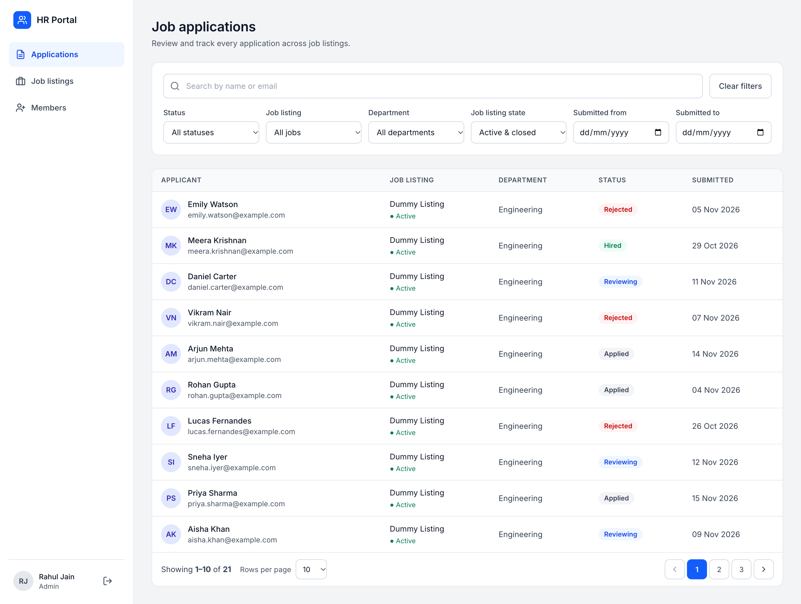
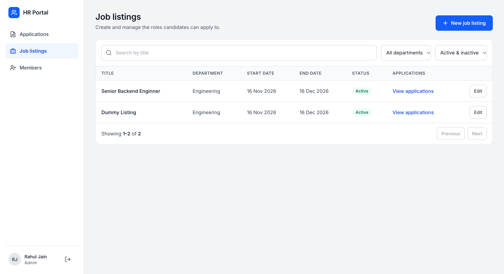
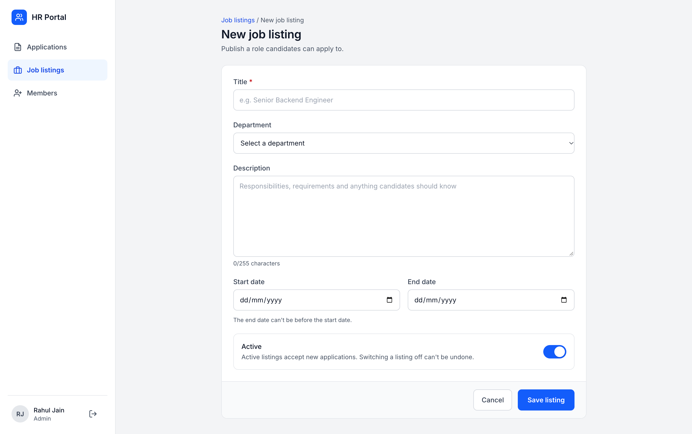
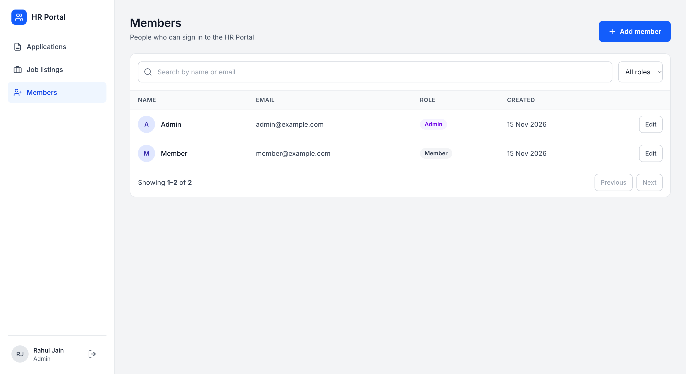
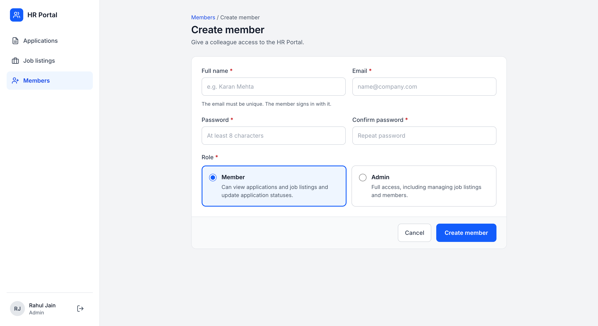
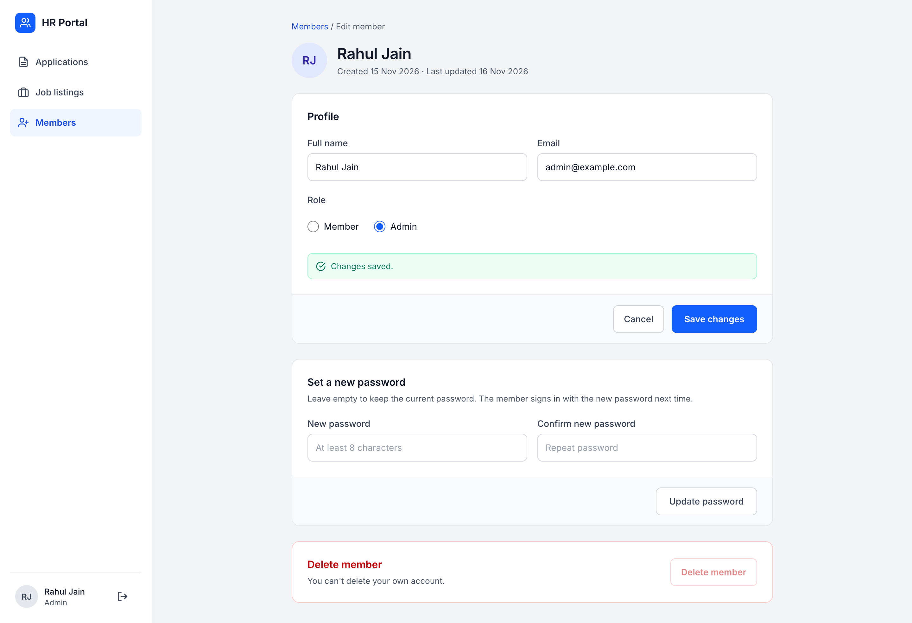
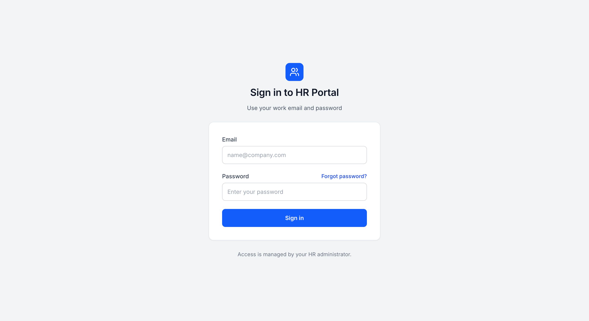
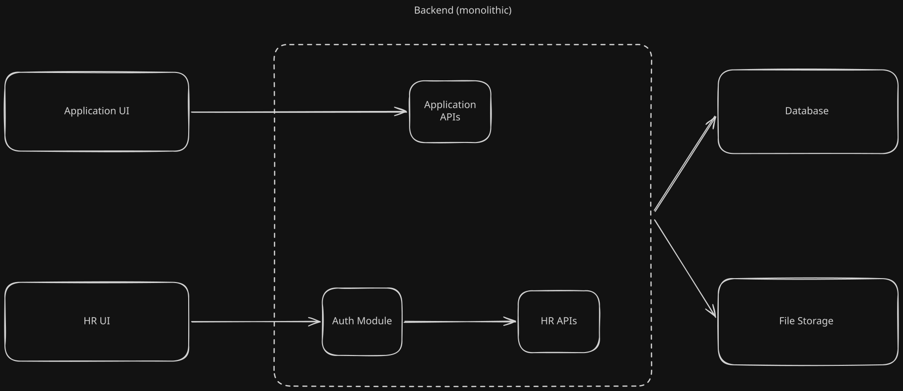
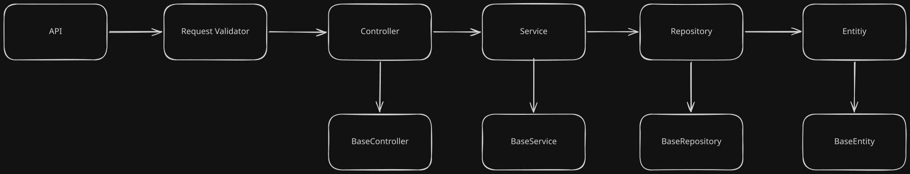
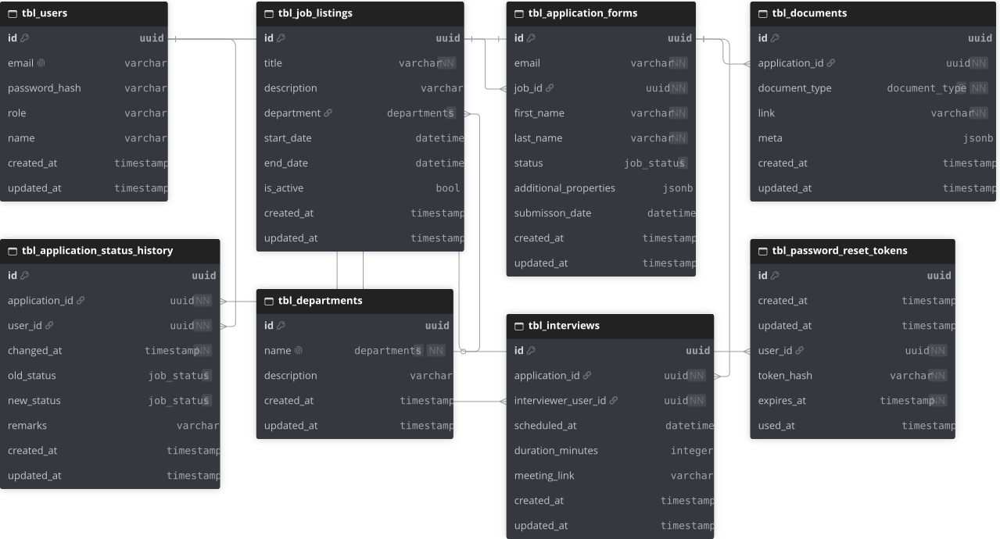

# HR & Applicant Tracking System (ATS)

## 📌 Overview

An HR and Applicant Tracking System for managing the hiring pipeline: departments, job postings, incoming applications, and the HR team itself. It's an npm-workspaces monorepo with a NestJS backend and a Next.js dashboard for HR staff.

Interview scheduling, document uploads, a status audit trail, and a public applicant portal are planned (see [Project Status](#-project-status)).

---

## 📸 Screenshots

**Applications:** search and filter every application by status, job, department, listing state, and submission date, with server-side pagination.



<table>
  <tr>
    <td width="50%" valign="top">
      <b>Job listings</b><br/>
      Filter by department and active state, and jump to each listing's applications.<br/><br/>
      
    </td>
    <td width="50%" valign="top">
      <b>New job listing</b><br/>
      Form validation, including end date after start date and a 255-character description limit.<br/><br/>
      
    </td>
  </tr>
  <tr>
    <td width="50%" valign="top">
      <b>Members</b><br/>
      Admins manage who can sign in, with search and role filters.<br/><br/>
      
    </td>
    <td width="50%" valign="top">
      <b>Create member</b><br/>
      Role-based access: Members review applications, and Admins manage listings and people.<br/><br/>
      
    </td>
  </tr>
  <tr>
    <td width="50%" valign="top">
      <b>Edit member</b><br/>
      Update profile and role, reset a password, or delete a member, with safeguards like not being able to delete your own account.<br/><br/>
      
    </td>
    <td width="50%" valign="top">
      <b>Sign in</b><br/>
      JWT stored in an HTTP-only cookie, with a self-service password reset by email.<br/><br/>
      
    </td>
  </tr>
</table>

---

## 💻 Tech Stack

**Frontend** (`apps/frontend-hr`)

*   **Framework:**  
*   **Language:** 
*   **Styling:** 

**Backend** (`apps/backend`)

*   **Framework:** 
*   **Language:** 
*   **ORM & Migrations:** MikroORM
*   **Authentication:**  stored in an HTTP-only cookie, with role-based access (`ADMIN`, `MEMBER`)
*   **Email:** Nodemailer over SMTP (used for password reset)

**Infrastructure & Data**

*   **Database:** 
*   **File Storage:**  (S3-compatible object storage for resumes and documents)
*   **Containerization:**  Compose for local Postgres and MinIO

---

## 📊 Project Status

- [x] Monorepo workspace setup
- [x] Backend API architecture (layered controllers, services, repositories)
- [x] Authentication (JWT cookie, RBAC, password reset by email)
- [x] Database migrations
- [x] HR dashboard (Next.js): login, members, job listings, applications
- [x] Department & job listing management
- [x] Application tracking with status updates and filters
- [x] Docker images for the backend and frontends
- [ ] Public applicant portal
- [ ] Application status history (audit trail)
- [ ] Document uploads to MinIO
- [ ] Interview scheduling
- [ ] Testing & deployment

---

## 🛠️ Getting Started

### Prerequisites

- Node.js 22+
- Docker and Docker Compose

### Setup

```bash
# 1. Install dependencies for all workspaces

npm install

# 2. Create your environment file, then fill in the values

cp .env.example .env

# 3. Start Postgres and MinIO

docker compose up -d postgres minio

# 4. Start the backend (http://localhost:3000); it applies pending migrations on startup

npm run dev:backend

# 5. In another terminal, start the HR dashboard (http://localhost:3001)

npm run dev:frontend-hr -- -p 3001
```

### Running everything in Docker

Instead of steps 3 to 5, Compose can build and run everything:

```bash
docker compose up -d --build
```

| Service | URL |
|---|---|
| `backend` | <http://localhost:3000> |
| `frontend-hr` | <http://localhost:3001> |
| `frontend-application` | <http://localhost:3002> |

The backend applies pending migrations each time it starts. Migrations are compiled into the image, so pass `--build` after creating one.

The backend and Next.js both default to port 3000, so pass `-p 3001` to the frontend. `FRONTEND_URL` (which the backend uses for CORS and password-reset links) defaults to `http://localhost:3001`.

MinIO's console is at <http://localhost:9001>. Log in with `MINIO_ROOT_USER` / `MINIO_ROOT_PASSWORD`.

### Creating the first admin user

There's no public sign-up, and only an `ADMIN` can create users through the API. To bootstrap the first admin, insert one directly into the database:

```bash
# Generate a bcrypt hash for your password

HASH=$(node -e "console.log(require('bcrypt').hashSync('ChangeMe123!', 10))")

# Insert the admin user (uses the values from your .env)

source .env
docker exec -i hr_postgres psql -U "$DB_USER" -d "$DB_NAME" -c \
  "INSERT INTO tbl_users (email, password, name, role) VALUES ('admin@example.com', '$HASH', 'Admin', 'ADMIN');"
```

Then log in at <http://localhost:3001/login> and change the password.

---

## 🔐 Environment Variables

All variables live in a single `.env` file at the repo root. The backend validates them at startup ([env.validation.ts](apps/backend/src/config/env.validation.ts)) and refuses to start if a required one is missing.

| Variable | Required | Default | Description |
|---|---|---|---|
| `NODE_ENV` | No | `development` | `development`, `production`, or `test` |
| `PORT` | No | `3000` | Backend HTTP port |
| `DB_HOST` | Yes | | Postgres host (`localhost` when using Compose) |
| `DB_PORT` | No | `5432` | Postgres port |
| `DB_USER` | Yes | | Postgres user (Compose also uses this to create it) |
| `DB_PASSWORD` | Yes | | Postgres password |
| `DB_NAME` | Yes | | Postgres database name |
| `MINIO_ROOT_USER` | Yes | | MinIO root user |
| `MINIO_ROOT_PASSWORD` | Yes | | MinIO root password (at least 8 characters) |
| `JWT_SECRET` | Yes | | Secret used to sign access tokens. Use a long random string. |
| `AUTH_COOKIE_NAME` | Yes | | Name of the auth cookie |
| `FRONTEND_URL` | No | `http://localhost:3001` | HR dashboard URL (CORS origin and reset-link base) |
| `SMTP_HOST` | No | | SMTP server for outgoing mail |
| `SMTP_PORT` | No | `587` | SMTP port |
| `SMTP_USER` | No | | SMTP username |
| `SMTP_PASSWORD` | No | | SMTP password |
| `MAIL_FROM` | No | `HR Portal <no-reply@localhost>` | Sender address for emails |

**Frontend** (`apps/frontend-hr`)

| Variable | Default | Description |
|---|---|---|
| `NEXT_PUBLIC_API_URL` | `http://localhost:3000` | Backend base URL |
| `NEXT_AUTH_COOKIE_NAME` | `access_token` | Must match `AUTH_COOKIE_NAME` |

> **Note:** Next.js reads `.env` files from its own app directory, not the repo root. To override the frontend defaults, put these variables in `apps/frontend-hr/.env.local`.

---

## 📁 Project Structure

```text
hr-dash/
├── apps/
│   ├── backend/          # NestJS API
│   │   ├── src/
│   │   │   ├── controllers/   # HTTP layer (extends BaseController)
│   │   │   ├── services/      # Business logic (extends BaseService)
│   │   │   ├── repositories/  # Data access (extends BaseRepository)
│   │   │   ├── entities/      # MikroORM entities (extends BaseUUIDEntity)
│   │   │   ├── dtos/          # Request validation (class-validator)
│   │   │   ├── guards/        # JWT and role guards
│   │   │   ├── modules/       # NestJS modules
│   │   │   └── migrations/    # MikroORM migrations
│   │   └── mikro-orm.config.ts
│   └── frontend-hr/      # Next.js HR dashboard
├── docs/images/          # Architecture, request flow, and DB diagrams
├── docker-compose.yml    # Postgres, MinIO, backend, and both frontends
└── .env.example
```

### Root scripts

| Script | What it does |
|---|---|
| `npm run dev:backend` | Start the backend in watch mode |
| `npm run dev:frontend-hr` | Start the HR dashboard dev server |
| `npm run db:migrate` | Apply pending migrations manually (the backend also does this on startup) |
| `npm run db:generate` | Generate a migration from entity changes |
| `npm run db:blank` | Create an empty migration |
| `npm run db:down` | Roll back the last migration |

---

## 🏗️ System Architecture

The system follows a client-server model with a monolithic backend.



### Components

*   **Client Interfaces:**
    *   **HR UI** (`apps/frontend-hr`): A secure internal dashboard where HR staff manage members, job postings, and applications.
    *   **Application UI** *(planned)*: A public frontend where candidates browse job listings and submit applications.
*   **Backend (Monolithic):**
    *   **Auth Module:** Handles login, logout, and password reset, and secures access from the HR UI.
    *   **HR APIs:** Protected endpoints for administrative tasks such as managing users, departments, job listings, and application statuses.
    *   **Application APIs** *(planned)*: Public endpoints for the Application UI, such as fetching active jobs and submitting forms.
*   **Infrastructure:**
    *   **Database:** PostgreSQL, storing all structured data.
    *   **File Storage:** MinIO, for applicant documents such as resumes, cover letters, and portfolios.

---

## 🔌 API Overview

All routes except `/auth/*` require a valid auth cookie. Routes marked **Admin** also require the `ADMIN` role.

| Resource | Routes |
|---|---|
| `/auth` | `POST /login`, `GET /logout`, `POST /forgot-password`, `GET /reset-password/:token`, `POST /reset-password` |
| `/user` | `GET /` (Admin), `GET /:id`, `POST /create` (Admin), `PATCH /:id` (Admin), `DELETE /:id` (Admin) |
| `/departments` | `GET /`, `POST /` (Admin), `PATCH /update-description/:id` (Admin) |
| `/job-listings` | `GET /`, `GET /:id`, `POST /` (Admin), `PATCH /:id` (Admin), `PATCH /:id/set-inactive` (Admin) |
| `/application-forms` | `GET /`, `GET /job/:jobId`, `GET /:id`, `POST /` (Admin), `PATCH /:id` (Admin), `PATCH /:id/status` |

---

## ⚙️ Backend Request Flow

The backend uses a layered architecture to keep concerns separated, as shown in the request flow diagram below.



### Request Lifecycle

1.  **API Routing:** NestJS routes the incoming request to a controller endpoint.
2.  **Guards:** `JwtAuthGuard` authenticates the request from the auth cookie, and `RolesGuard` enforces the `@Roles(...)` requirement.
3.  **Request Validation:** DTOs validated with `class-validator` reject payloads that don't match the expected schema.
4.  **Controller:** Handles the HTTP request and response and delegates to the service layer. Extends `BaseController`.
5.  **Service:** Contains the business logic. Extends `BaseService`.
6.  **Repository:** Handles data access and abstracts database queries. Extends `BaseRepository`.
7.  **Entity:** MikroORM entity defining the table schema. Extends `BaseUUIDEntity` (UUID primary key, `created_at`, `updated_at`).

---

## 🗄️ Database Schema

The schema is designed to track the full lifecycle of an application, as shown in the entity-relationship diagram below. The diagram includes planned tables.



### Implemented tables

*   **`tbl_users`**: System users (HR staff, admins) with a role (`ADMIN` or `MEMBER`) and a bcrypt-hashed password.
*   **`tbl_departments`**: Organizational departments.
*   **`tbl_job_listings`**: Job postings with active dates, department, and description.
*   **`tbl_application_forms`**: The central table linking candidates to jobs. Tracks the current status and stores custom form fields as JSONB.
*   **`tbl_password_reset_tokens`**: Single-use, expiring password reset tokens linked to a user.

### Planned tables

*   **`tbl_application_status_history`**: An audit log of every status change, recording who made the change and when.
*   **`tbl_documents`**: Metadata and links to files in MinIO (such as resumes), tied to an `application_id`.
*   **`tbl_interviews`**: Scheduled interviews linking applications to interviewers, with duration and meeting link.

---

## 🚀 Key Features

*   **Role-Based Access:** `ADMIN` and `MEMBER` roles enforced on every protected endpoint.
*   **Secure Authentication:** JWT in an HTTP-only cookie, with password reset by email.
*   **Job & Department Management:** Create, edit, and deactivate job postings grouped by department.
*   **Application Tracking:** Review applications, filter them, and update their status.
*   **Dynamic Application Forms:** Custom per-application fields stored as JSONB.
*   **Full Audit Trail** *(planned)*: A record of every status change for transparency and compliance.
*   **Interview Scheduling** *(planned)*: Connect applicants with interviewers and meeting links.
*   **Document Management** *(planned)*: Store applicant documents in MinIO.
